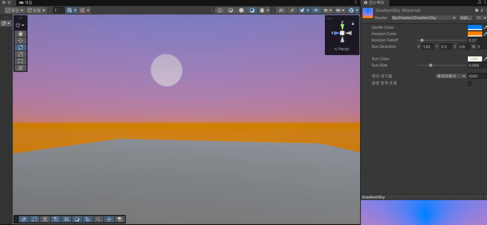
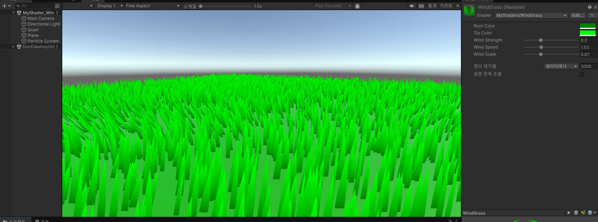
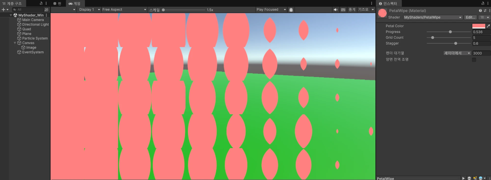

# SUBMISSION — 나만의 셰이더 제작

HLSL 코드(`.shader`)로 작성한 셰이더 3개입니다. 먼저 AI로 만들고 싶었던 목표 씬을 구현해본 다음, 각각 간단화 한 버전으로 직접 구현해 보았습니다.

AI로 만든 목표 예시 씬은 과제물과 구분해 `Assets/03. AIReference_Meadow/` 폴더에 따로 두었으며, 평가 대상이 아닙니다(설명은 [README](Assets/03.%20AIReference_Meadow/README.md) 참고).

| 번호 | 셰이더 | 분야 | 핵심 방식 | 데모 씬 |
| --- | --- | --- | --- | --- |
| 01 | `MyShaders/GradientSky` | 스카이박스 | 프래그먼트 셰이더에서 바라보는 방향으로 색 계산 | `MyShader_GradientSky.unity` |
| 02 | `MyShaders/WindGrass` | 3D 오브젝트(파티클) | 정점 셰이더에서 위치를 움직임 | `MyShader_WindGrass.unity` |
| 03 | `MyShaders/PetalWipe` | UI 화면 전환 | 화면을 칸으로 나눠 알파 마스크로 그림 | `MyShader_PetalWipe.unity` |

작성 범위: 셰이더의 구조(프로퍼티, 구조체, `vert`/`frag`, 렌더 상태)와 값의 연결은 직접  한땀한땀 작성해보며 감을 익혔습니다. 수식 함수(`SunDisk`, `BladeMask`, `WindWave`, `GridCell`, `PetalMask`, `CellProgress`)는 AI의 도움을 받아 가져와 붙였습니다.

---

## 01. GradientSky — 그라데이션 하늘과 태양

**무엇을 하는가**
지평선 색에서 천정 색으로 이어지는 하늘을 그리고, 지정한 방향에 태양 원반을 띄웁니다.

**동작 원리**
- 스카이박스 메시의 정점 오브젝트 좌표를 "바라보는 방향"으로 보고, `vert`에서 `Varyings`에 담아 `frag`로 넘깁니다.
- `frag`에서 방향을 `normalize`하면 `y`가 높이가 됩니다(천정 1, 지평선 0). `saturate`로 0–1로 자릅니다.
- 높이에 `pow(t, _HorizonFalloff)`를 적용해 지평선 색 띠의 두께를 조절한 뒤, `lerp`로 두 색을 섞습니다.
- `SunDisk`는 바라보는 방향과 태양 방향이 얼마나 가까운지로 원반 안(1)과 밖(0)을 구합니다.
- 스카이박스라서 `Queue`는 `Background`, `ZWrite Off`, `Cull Off`입니다.

**프로퍼티**
| 이름 | 효과 |
| --- | --- |
| Zenith Color / Horizon Color | 천정과 지평선의 색 |
| Horizon Falloff | 작을수록 지평선 색 띠가 얇아짐 |
| Sun Direction | 태양의 위치(방향) |
| Sun Color (HDR) | 태양의 색과 밝기 |
| Sun Size | 태양 원반의 크기 |

**직접 바꾸거나 더한 부분**
- 태양을 최종 색에 더하지 않고 지평선 색 쪽에 더했습니다(`lerp(_HorizonColor + sun, _ZenithColor, t)`). 그래서 태양이 높이 있을수록 하늘색에 묻혀 옅게 보입니다.

---

## 02. WindGrass — 바람에 흔들리는 잔디 평원

**무엇을 하는가**
사각형 한 장을 풀잎 모양으로 잘라 내고, 바람에 물결치듯 흔들리게 합니다. 파티클 시스템으로 10000장을 뿌려 평원을 만들었습니다.

**동작 원리**
- 색: `frag`에서 `uv.y`(뿌리 0, 끝 1)로 뿌리 색과 끝 색을 `lerp`합니다.
- 모양: `BladeMask`가 풀잎 바깥에서 음수를 돌려주고, `clip`이 그 픽셀을 버립니다.
- 움직임: `vert`에서 오브젝트 좌표를 `TransformObjectToWorld`로 월드 좌표로 바꾸고, `WindWave` 값만큼 x 방향으로 옮긴 뒤 `TransformWorldToHClip`으로 화면 좌표로 보냅니다.
- 옮기는 양에 `uv.y * uv.y`를 곱해서 뿌리는 고정되고 끝으로 갈수록 많이 휩니다.
- 바람을 월드 좌표로 계산하기 때문에 풀잎마다 위치에 따라 흔들리는 타이밍이 달라져 물결처럼 보입니다.
- 풀잎은 양면이 보여야 해서 `Cull Off`이고, 불투명 오브젝트라 `Queue`는 `Geometry`입니다.

**프로퍼티**
| 이름 | 효과 |
| --- | --- |
| Root Color / Tip Color | 뿌리와 끝의 색 |
| Wind Strength | 휘는 정도 (0이면 멈춤) |
| Wind Speed | 흔들리는 빠르기 |
| Wind Scale | 물결의 촘촘함 |

**직접 바꾸거나 더한 부분**
- 풀잎 배치를 파티클 시스템으로 생성하도록 해보았습니다!

---

## 03. PetalWipe — 꽃잎 화면 전환

**무엇을 하는가**
`Progress` 값 하나로 화면을 꽃잎으로 덮는 전환 효과입니다. 0이면 투명하고, 올리면 왼쪽부터 칸마다 꽃잎이 자라나 1에서 화면 전체가 덮입니다.

**동작 원리**
- 화면 전체를 덮는 UI Image 한 장에 그립니다.
- `GridCell`이 화면 `uv`를 정사각형 칸으로 나누고, 픽셀마다 "몇 번 칸의 어느 위치인지"를 구합니다.
- `CellProgress`가 칸 번호로 그 칸의 진행도를 구합니다. 왼쪽 칸일수록 먼저 시작하고 칸마다 조금씩 어긋납니다.
- `PetalMask`가 칸 안 위치와 진행도로 꽃잎 안(1)과 밖(0)을 구하고, 이 값을 알파로 씁니다. 색은 항상 `Petal Color`입니다.
- `Blend SrcAlpha OneMinusSrcAlpha`로 알파만큼 뒤 화면과 섞이므로, 꽃잎 밖은 뒤 장면이 그대로 보입니다.
- UI라서 `Queue`는 `Transparent`, `ZWrite Off`, `ZTest Always`입니다.

**프로퍼티**
| 이름 | 효과 |
| --- | --- |
| Petal Color | 꽃잎(덮는 화면)의 색 |
| Progress | 전환 진행도 (0 투명 → 1 전체 덮임) |
| Grid Count | 화면 세로 방향의 칸 수 |
| Stagger | 칸마다 시작 시점이 벌어지는 정도 (0이면 동시에 자람) |

**직접 바꾸거나 더한 부분**
- 마름모가 순서대로가 아니라 꽃잎이 약간은 다른 시간대로 나타나게 하고 싶어서 모양이 둥근 형태로 퍼지도록하고 전체 진행도안에 각 격자마다의 진행도를 따로 주었습니다!

---

## 세 셰이더의 렌더 상태 비교

| 셰이더 | Queue | ZWrite | Blend | 이유 |
| --- | --- | --- | --- | --- |
| GradientSky | Background | Off | 없음 | 가장 먼저, 모든 것의 뒤에 그림 |
| WindGrass | Geometry | On(기본) | 없음 | 불투명 오브젝트라 깊이를 기록 |
| PetalWipe | Transparent | Off | SrcAlpha OneMinusSrcAlpha | 화면 위에 반투명으로 덮음 |
